

# Payment Service · CI Build Pipeline (`FinTech-Payment-CI-Microservice-Project`)

> **Programming language: Go.** This is a **Payment Service** microservice (the Java Spring Boot services are the Ledger; this service is written in Go).

This repo is the **CI side** of the Payment Service: it builds the Go code, runs the tests, scans the code and the image, pushes the image to Amazon ECR, and then hands over to the CD repo `FinTech-Payment-CD-Microservice-Project`.

> Status: **planned**. The pipeline below is the design this repo will follow. No workflow file is committed yet.

---

## At a Glance

| Item | Value |
|---|---|
| Service | Payment Service |
| Language | Go |
| Repo role | CI (build, test, scan, push) |
| Companion repo | `FinTech-Payment-CD-Microservice-Project` |
| Steps | 12 |
| Tools | 12 |
| Diagrams | 12 animated diagrams in `docs/diagrams/` |

---

## Diagram Gallery

Each diagram is an animated SVG in `docs/diagrams/`. The moving dots show data flowing along the arrows. Each one has a short explanation.

### 01 · Branch lifecycle

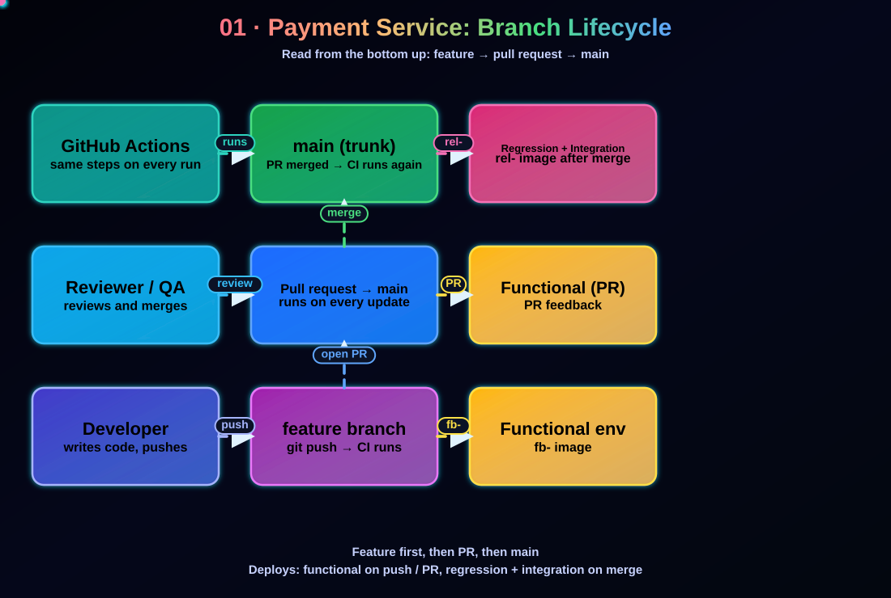

**What it shows:** Shows how a change moves from `feature` to `main`. Feature pushes deploy `fb-` builds to Functional. A PR runs the pipeline again. A merge runs it on main and deploys `rel-` builds to Regression and Integration.

### 02 · Pipeline overview

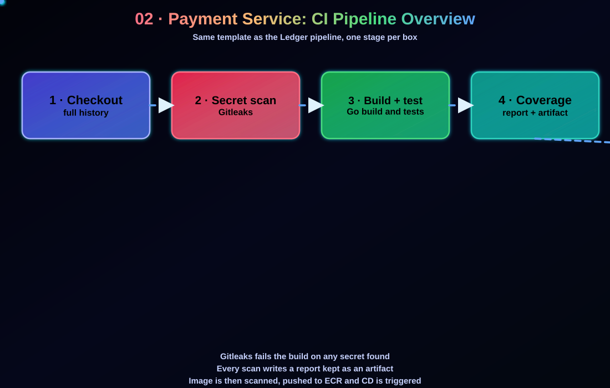

**What it shows:** All 12 steps as one flow. Each box is one stage, with the tool used for it.

### 03 · Checkout and secret scan

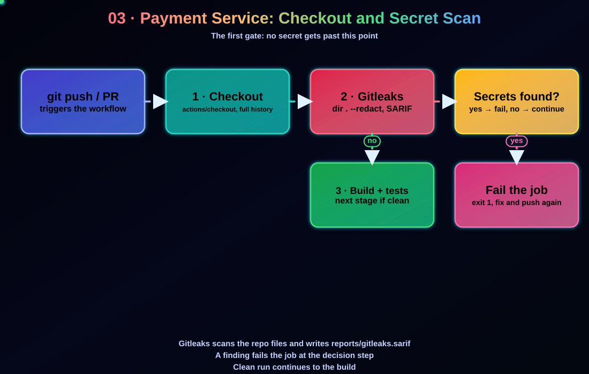

**What it shows:** The first gate. Gitleaks runs on the checked-out files. A finding fails the job before anything is built.

### 04 · Build and tests

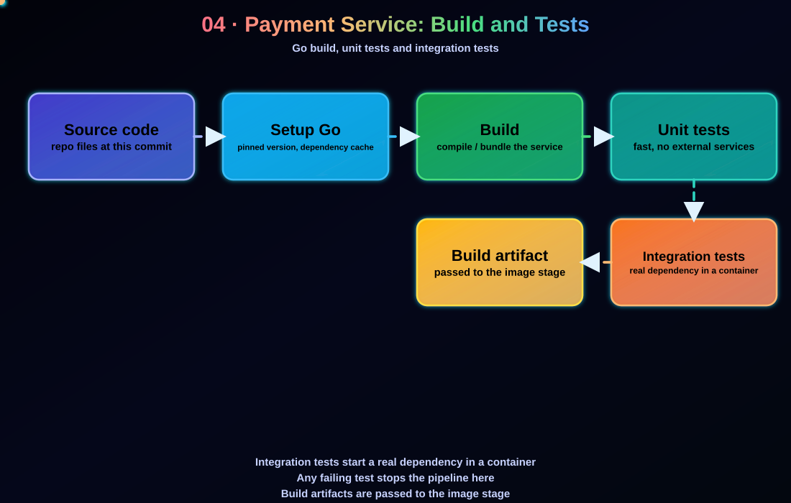

**What it shows:** The Go build, unit tests and integration tests. Integration tests use a real dependency in a container, not a mock.

### 05 · Coverage

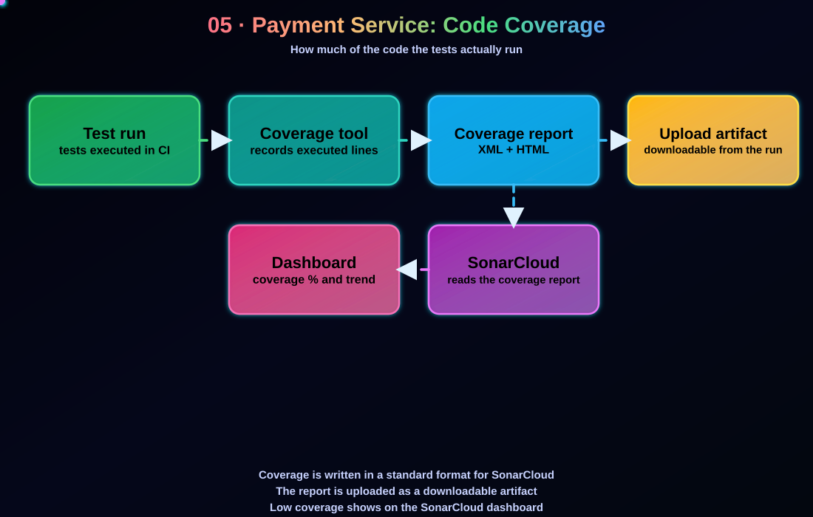

**What it shows:** The test run records coverage, the report is uploaded as an artifact, and SonarCloud reads it for the dashboard.

### 06 · Dependency scan (Trivy SCA)

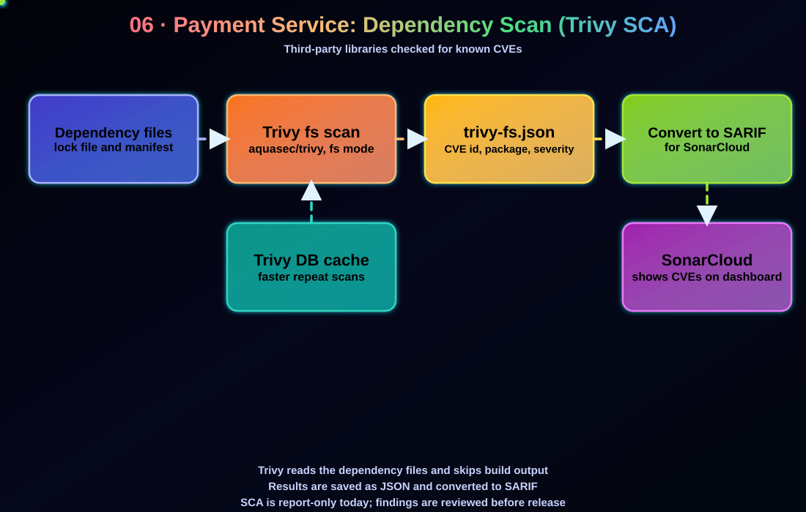

**What it shows:** Trivy checks dependency files for known CVEs. Results are saved as JSON and converted to SARIF for SonarCloud. Report only today.

### 07 · SAST and quality gate

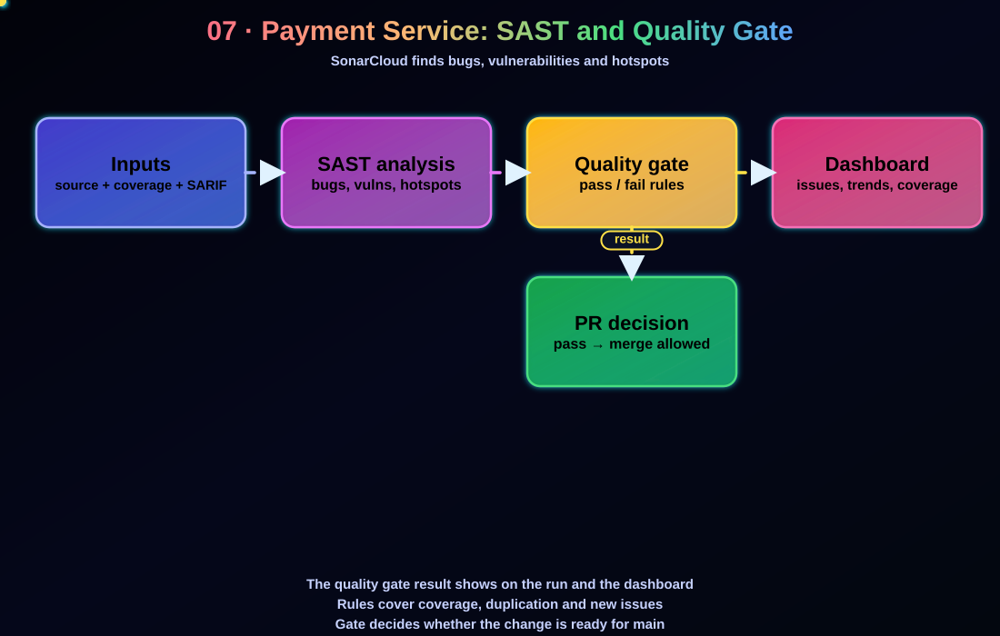

**What it shows:** SonarCloud analyses the code. The quality gate result decides whether the change is ready for main.

### 08 · Image build

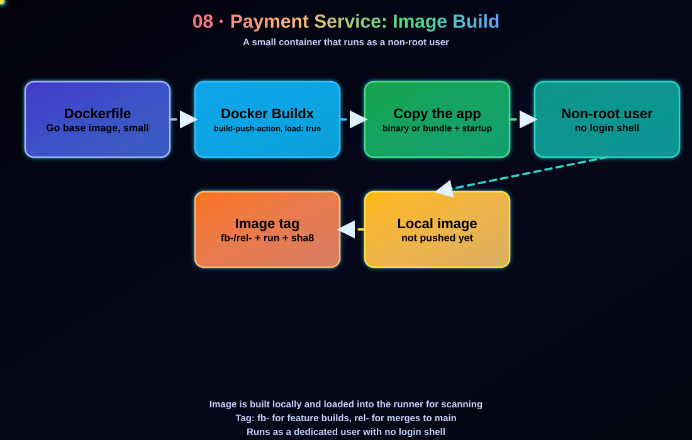

**What it shows:** Docker Buildx builds a small image. It runs as a non-root user with no login shell.

### 09 · Image scan

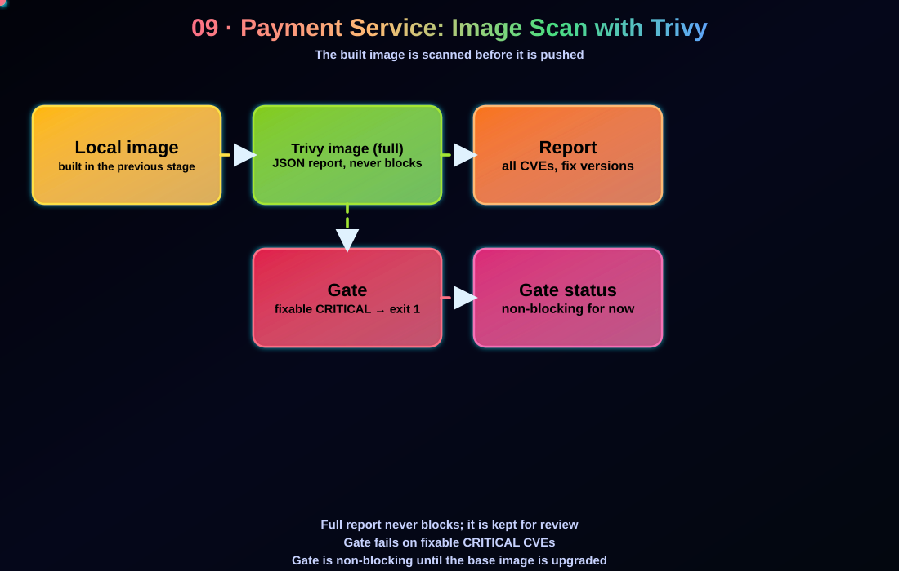

**What it shows:** Trivy scans the local image before it is pushed. The gate fails only on fixable CRITICAL CVEs and is non-blocking for now.

### 10 · ECR push and scan

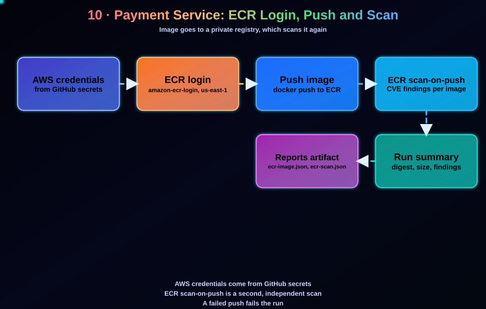

**What it shows:** Logs in to ECR, pushes the image and reads the ECR scan-on-push report. The report is saved as an artifact.

### 11 · Routing to environments

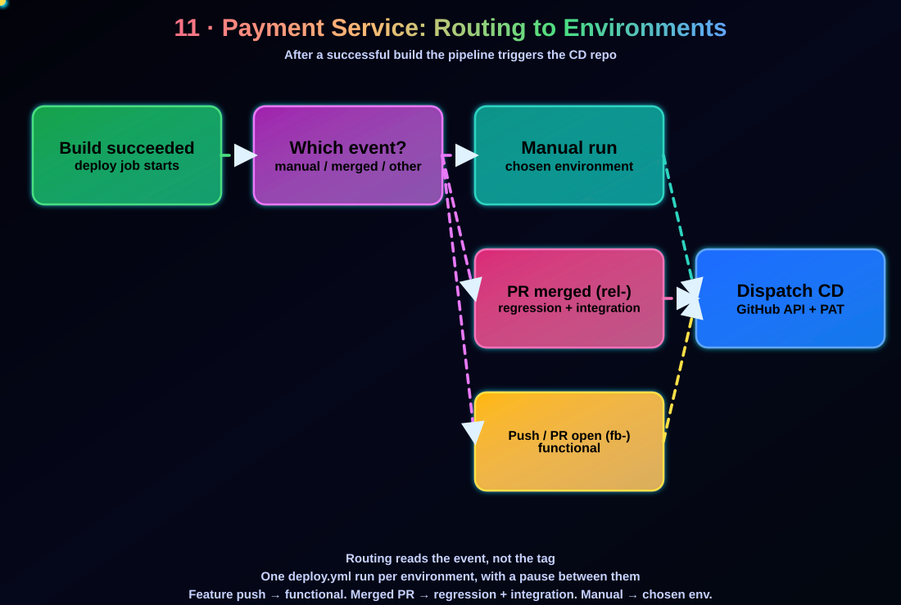

**What it shows:** After a successful build, the pipeline picks environments from the event: feature → functional, merged PR → regression and integration, manual → the chosen one.

### 12 · Delivery to EKS

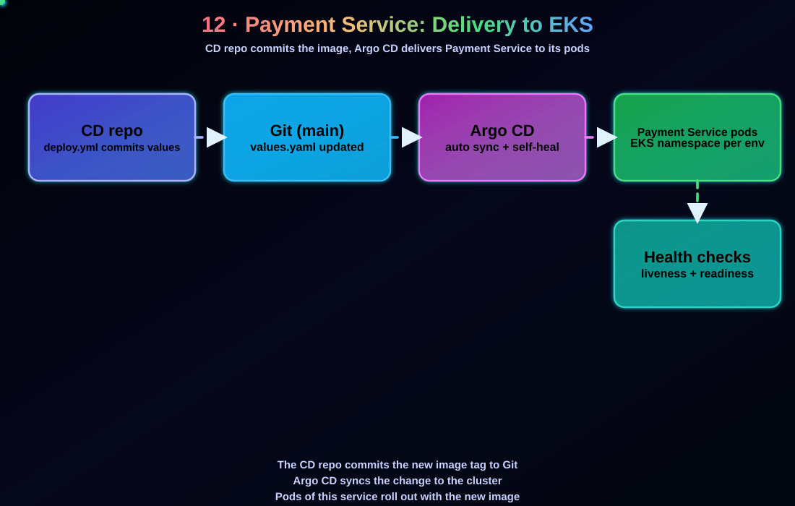

**What it shows:** The CD repo commits the new image tag. Argo CD syncs it to EKS, and the Payment Service pods roll out with the new image.

---

## Steps

| # | Step | What it does | Tool |
|---|---|---|---|
| 1 | Checkout | Downloads the code with full Git history | actions/checkout@v4 |
| 2 | Secret scan | Finds passwords and keys in the repo files. A finding fails the build | Gitleaks |
| 3 | Build and tests | Builds the Go service, runs unit and integration tests (real dependency in a container) | Go toolchain, test runner, Testcontainers |
| 4 | Coverage | Measures which lines the tests run and uploads the report | Coverage tool (JaCoCo-style XML) |
| 5 | SCA scan | Checks dependencies for known CVEs (report only) | Trivy (filesystem) |
| 6 | Trivy gate | Fails on fixable CRITICAL CVEs in the image (non-blocking for now) | Trivy (image) |
| 7 | SAST | Static analysis for bugs and security issues | SonarCloud |
| 8 | Quality gate | Pass or fail rules on the SonarCloud analysis | SonarCloud quality gate |
| 9 | Image build | Builds a small container image that runs as a non-root user | Docker Buildx |
| 10 | Image scan | Scans the image; full report never blocks | Trivy (image) |
| 11 | ECR push and scan | Logs in to ECR, pushes the image, reads the scan-on-push result | AWS CLI, Amazon ECR |
| 12 | Trigger CD | Starts `deploy.yml` in the CD repo for the right environments | GitHub REST API + PAT |

---

## Tool Stack

| # | Tool | Category | What it does here |
|---|---|---|---|
| 1 | **GitHub Actions** | CI orchestration | Runs the steps in order, on push, PR and merge |
| 2 | **Gitleaks** | Secret scanning | Stops secrets reaching main |
| 3 | **Go toolchain** | Build and test | Compiles and tests the Payment Service |
| 4 | **Testcontainers** | Integration tests | Starts a real dependency in a throwaway container |
| 5 | **Coverage tool** | Code coverage | Shows which code the tests run |
| 6 | **Trivy (filesystem)** | SCA | Known CVEs in dependency files |
| 7 | **SonarCloud** | SAST + quality gate | Bugs, vulnerabilities, hotspots, coverage rules |
| 8 | **Docker Buildx** | Image build | Builds the container image |
| 9 | **Trivy (image)** | Container scan | CVEs inside the image |
| 10 | **Amazon ECR** | Registry + scan | Private image storage and scan-on-push |
| 11 | **AWS CLI + jq** | Reporting | Reads ECR results and writes the run summary |
| 12 | **GitHub REST API + PAT** | Cross-repo trigger | Starts `deploy.yml` in `FinTech-Payment-CD-Microservice-Project` |

---

## Interview Talking Points

- Shift left: secrets, dependencies and code are checked before the image is built.
- Build once, deploy many: one image per run, promoted by tag.
- Traceability: the tag holds the run number and commit SHA.
- CI and CD are separate: this repo builds and scans, the CD repo deploys through Argo CD.

---

## Related Repos

- Companion repo: `FinTech-Payment-CD-Microservice-Project`
- Ledger service (Java Spring Boot) pipeline: `FinTech-Ledger-CI-MicroService-Project` and `FinTech-Ledger-CD-Microservice-Project`
